# Metodología y resultados de la detección prodrómica de la enfermedad de Alzheimer mediante Vision Transformers (ViT-B/16) en resonancia magnética estructural

**Autores:** Juan Simancas, Malak Sánchez  
**Institución:** Universidad del Magdalena — Facultad de Ingeniería — Programa de Ingeniería de Sistemas  
**Santa Marta, Colombia**  
**Contacto:** `{jsimancas, msanchez}@unimagdalena.edu.co`  
**Director:** Sergio Lubo  
**Asignatura:** Seminario de Investigación III (2026-II)  
**Fecha:** Noviembre de 2026  
**Documento PDF compilado oficial (formato dos columnas):** [`docs/reports/Articulo_Final_Seminario_III.pdf`](file:///c:/Users/Juan%20Simancas/Documents/Universidad%20del%20Magdalena/Seminario%20III/alzheimer-vit-smri/docs/reports/Articulo_Final_Seminario_III.pdf)

---

## Resumen

El diagnóstico temprano de la enfermedad de Alzheimer (EA) representa un reto fundamental para la medicina personalizada y la neuroimagen computacional. En este artículo se desarrolla la metodología completa, la fundamentación teórica y la evaluación empírica de un sistema de aprendizaje profundo basado en la arquitectura Vision Transformer (ViT-B/16) para la clasificación triclase entre Control Normal (CN), Deterioro Cognitivo Leve (MCI) y Demencia tipo Alzheimer (AD) a partir de resonancia magnética estructural ponderada en T1 (sMRI). A partir de cohortes internacionales ADNI y OASIS (2015–2025), se estableció un protocolo de depuración asistido por el estándar PRISMA 2020 y una partición estratificada estricta a nivel de sujeto ($N = 1.200$) que erradica la fuga de datos (*subject leakage*). Se formula un preprocesamiento canónico 2.5D centrado en el hipocampo ($z = -12\text{ mm}$ en espacio MNI152) con normalización z-score parenquimal ($I > 0$), el cual reduce la huella de memoria VRAM en un 86,8 % frente a modelos volumétricos densos. Para garantizar interpretabilidad clínica, se diseñó un módulo post-hoc de Attention Rollout con conexiones residuales ($w = 0,5$), corroborando que la atención se concentra prioritariamente en la formación hipocampal y corteza entorrinal. En evaluación ciega independiente ($N = 180$), el modelo obtuvo una Exactitud de 91,7 %, Exactitud Balanceada de 91,7 %, Macro AUC de 0,982 y una Sensibilidad de 88,3 % en la fase prodrómica (MCI). La optimización mediante compilación JIT TorchScript redujo la latencia en CPU en un 14,9 % con degradación numérica nula ($\Delta < 10^{-7}$). El proyecto cuenta con trazabilidad total respaldada por 200 pruebas automatizadas.

**Palabras clave:** Resonancia magnética estructural, enfermedad de Alzheimer, Vision Transformers, representación 2.5D, Attention Rollout, TorchScript, interpretabilidad clínica.

## Abstract

Early diagnosis of Alzheimer's disease (AD) is a critical objective in personalized medicine and computational neuroimaging. This paper presents the methodological framework, theoretical foundations, and empirical validation of a deep learning system based on the Vision Transformer (ViT-B/16) architecture for three-class classification among Cognitively Normal (CN), Mild Cognitive Impairment (MCI), and Alzheimer's Dementia (AD) using structural T1-weighted MRI (sMRI). Leveraging international cohorts from ADNI and OASIS (2015–2025), a systematic data curation protocol guided by PRISMA 2020 was conducted, enforcing strict subject-level stratified partitioning ($N = 1,200$) to eliminate subject leakage. A canonical 2.5D hippocampal-centered preprocessing protocol ($z = -12\text{ mm}$ in MNI152 space) with parenchymal z-score normalization ($I > 0$) was implemented, reducing GPU VRAM demand by 86.8 % compared to dense 3D volumetric baselines. To ensure clinical interpretability, a post-hoc residual Attention Rollout module ($w = 0.5$) was integrated, validating that attention focus aligns with hippocampal and entorhinal cortex atrophy. On an independent blind test set ($N = 180$), the architecture achieved 91.7 % Accuracy, 91.7 % Balanced Accuracy, 0.982 Macro AUC, and 88.3 % Sensitivity in the prodromal MCI phase. TorchScript JIT compilation reduced CPU latency by 14.9 % with zero numerical degradation ($\Delta < 10^{-7}$). The codebase is fully verified via 200 automated pytest test cases.

**Keywords:** Structural MRI, Alzheimer's disease, Vision Transformers, 2.5D representation, Attention Rollout, TorchScript, clinical interpretability.

---

## 1. Introducción y planteamiento del problema

La enfermedad de Alzheimer (EA) constituye el trastorno neurodegenerativo primario más prevalente a escala global, representando entre el 60 % y el 70 % de los casos de demencia diagnosticados según informes epidemiológicos de la Organización Mundial de la Salud (OMS, 2023). Desde una perspectiva fisiopatológica, la EA se caracteriza por la progresiva acumulación extracelular de placas de péptido beta-amiloide y la formación intraneuronal de ovillos neurofibrilares de proteína tau hiperfosforilada. Dichos fenómenos moleculares inducen disfunción sináptica masiva, pérdida neuronal y atrofia macroscópica del tejido cerebral, iniciando de forma temprana en las estructuras del lóbulo temporal medial, particularmente la formación hipocampal y la corteza entorrinal, para posteriormente extenderse a áreas corticales asociativas temporo-parietales y frontales.

En la evolución clínica de la enfermedad se distinguen tres fases bien consolidadas: el estado de Control Normal (CN), caracterizado por indemnidad cognitiva acorde a la edad y nivel educativo; el Deterioro Cognitivo Leve (MCI, *Mild Cognitive Impairment*), caracterizado por decremento medible en funciones mnésicas o ejecutivas sin compromiso significativo de las actividades de la vida diaria; y la Demencia tipo Alzheimer (AD), donde la dependencia funcional del paciente se torna manifiesta. El estadio de MCI representa la ventana de oportunidad terapéutica crítica, dado que los tratamientos farmacológicos y las intervenciones modificadoras de la enfermedad alcanzan su máxima eficacia potencial de preservación neuronal antes del establecimiento de daño tisular irreversible.

La resonancia magnética estructural ponderada en T1 (sMRI) representa la modalidad de neuroimagen no invasiva de elección para la evaluación morfométrica del encéfalo *in vivo*. No obstante, la inspección visual convencional por parte de médicos radiólogos exhibe una marcada variabilidad inter e intra-observador (coeficientes kappa frecuentemente inferiores a 0,70 en estadios tempranos), además de requerir una considerable inversión de tiempo profesional. Este escenario ha motivado el desarrollo de sistemas computacionales de apoyo al diagnóstico basados en aprendizaje automático.

Pese a que las Redes Neuronales Convolucionales (CNN) en dos y tres dimensiones han dominado este campo durante la última década, adolecen de dos limitaciones estructurales determinantes: (1) el sesgo inductivo de localidad espacial restringe el campo receptivo de los operadores convolucionales, dificultando la captura de correlaciones anatómicas de largo alcance entre estructuras cerebrales distales que co-degeneran durante la progresión de la patología; y (2) los modelos convolucionales tridimensionales densos demandan una extraordinaria asignación de memoria de video (VRAM) y capacidad de cómputo, lo cual restringe su despliegue en infraestructuras hospitalarias convencionales carentes de aceleradores de hardware de alta gama.

Para superar tales restricciones, este trabajo investiga la adaptación de los Vision Transformers (ViT), introducidos por Dosovitskiy et al. (2021), aprovechando su mecanismo de autoatención global sobre parches visuales combinados con una estrategia de representación canónica 2.5D. Esta combinación permite modelar patrones atróficos globales con alta resolución y un costo computacional compatible con estaciones de trabajo estándar basadas en CPU.

---

## 2. Marco teórico y estado del arte

El análisis automatizado de neuroimagen para el diagnóstico de Alzheimer ha evolucionado significativamente. Los primeros enfoques rigurosos se basaron en morfometría basada en vóxeles (VBM) y clasificadores lineales. Klöppel et al. (2008) demostraron la viabilidad de Support Vector Machines (SVM) para discriminar AD de controles sanos, mientras que Cuingnet et al. (2011) llevaron a cabo una evaluación comparativa sistemática de diez métodos morfométricos sobre la base de datos ADNI, señalando que la sensibilidad en la detección de la fase MCI se mantenía en niveles insatisfactorios (< 65 %).

### 2.1 Modelos convolucionales en neuroimagen

Con el advenimiento del aprendizaje profundo, diversos autores exploraron arquitecturas convolucionales. Hosseini-Asl et al. (2016) emplearon autoencoders 3D preentrenados sobre sMRI para extraer características volumétricas no supervisadas, alcanzando un 93,5 % en la clasificación binaria AD vs. CN, pero con alto costo de entrenamiento. Lian et al. (2018) propusieron redes jerárquicas discriminativas basadas en regiones de interés (ROI-CNN) obteniendo un 83,1 % de exactitud triclase en ADNI-1.

Ghazi et al. (2019) evaluaron redes 3D densas (VGG, ResNet) sobre volúmenes completos de $192 \times 192 \times 160$, reportando 88,4 % de exactitud triclase con 3D-ResNet-50. No obstante, el consumo de VRAM superó los 16 GB por muestra individual, evidenciando el cuello de botella computacional del procesamiento tridimensional. Como alternativa intermedia, Zhang et al. (2021) aplicaron una aproximación 2.5D multiplanar acoplada a una red DenseNet-121 en OASIS-3, logrando 87,2 % de exactitud con un consumo de VRAM de 2,8 GB, confirmando que la combinación de cortes ortogonales contiguos preserva la información de contexto espacial suficiente sin incurrir en la complejidad de convoluciones 3D completas.

### 2.2 Emergencia de los Vision Transformers

A diferencia de las redes convolucionales, el modelo Vision Transformer (Dosovitskiy et al., 2021) reemplaza las operaciones de convolución local por bloques de autoatención multi-cabeza (*Multi-Head Self-Attention*, MHSA). Al procesar una imagen descompuesta en una cuadrícula regular de parches no solapados proyectados a un espacio vectorial de dimensión $D$, la atención permite que cada posición atienda directamente a todas las demás en cada capa, independientemente de su distancia geométrica.

En el dominio médico, Chen et al. (2021) presentaron TransUNet para segmentación de órganos abdominales, y Yao et al. (2023) formularon Swin Transformer 3D para el diagnóstico de EA sobre ADNI-2, alcanzando un 90,2 % de exactitud triclase pero requiriendo clústeres de 64 GB de GPU. La presente investigación se apoya en estas lecciones para formular una adaptación de ViT-B/16 sustentada en representación axial 2.5D, combinando la potencia de la atención global con una huella de memoria contenida.

### 2.3 Interpretabilidad en inteligencia artificial clínica

La opacidad inherente a los modelos de caja negra constituye uno de los mayores obstáculos para su adopción por la comunidad clínica y los entes regulatorios (FDA, 2021). Mientras que en CNNs los métodos basados en gradientes como Grad-CAM (Selvaraju et al., 2017) han sido la norma, en arquitecturas basadas en transformadores la atención se dispersa y degrada a través de las capas sucesivas. Abnar y Zuidema (2020) formularon el algoritmo Attention Rollout, el cual modela linealmente el flujo de información mediante la multiplicación recursiva de matrices de atención adicionadas con la matriz identidad, garantizando la trazabilidad desde el token [CLS] hasta cada región anatómica original.

**Tabla 1. Síntesis comparativa de aportes representativos en el estado del arte.**

| Autor y Año | Modelo | Representación | Dataset | Clases | Exactitud |
| :--- | :--- | :--- | :---: | :---: | :---: |
| Cuingnet (2011) | VBM + SVM | Volumen 3D | ADNI-1 | CN/MCI/AD | 63,2 % |
| Lian (2018) | ROI-CNN 3D | Parches 3D | ADNI-1 | CN/MCI/AD | 83,1 % |
| Ghazi (2019) | 3D-ResNet-50 | Volumen 3D | ADNI-1 | CN/MCI/AD | 88,4 % |
| Zhang (2021) | DenseNet-121 | Multiplanar 2.5D | OASIS-3 | CN/MCI/AD | 87,2 % |
| Yao (2023) | Swin Transf. 3D | Volumen 3D | ADNI-2 | CN/MCI/AD | 90,2 % |
| **Propuesto (2026)** | **ViT-B/16 2.5D** | **Triplete 2.5D** | **ADNI/OASIS** | **CN/MCI/AD** | **91,7 %** |

---

## 3. Metodología de la investigación

El presente trabajo adopta un enfoque de investigación cuantitativo, de diseño experimental y de alcance explicativo. Se persigue contrastar la eficacia de la representación 2.5D acoplada a transformadores visuales frente a las técnicas convolucionales convencionales, controlando rigurosamente los sesgos de particionamiento y normalización.

### 3.1 Hipótesis y formulación de variables

- **Hipótesis científica ($H_1$):** La integración de la autoatención global mediante ViT-B/16 sobre tripletes axiales canónicos 2.5D centrados en la región hipocampal permite alcanzar una Exactitud diagnóstica superior al 90 % y una Sensibilidad en MCI superior al 85 % en clasificación triclase, manteniendo una latencia de inferencia en CPU inferior a 600 ms.
- **Variable independiente:** Arquitectura de modelado y representación de entrada (ViT-B/16 2.5D vs. baselines CNN).
- **Variables dependientes:** Exactitud global, Exactitud balanceada, Sensibilidad por clase (especialmente MCI), Macro AUC, latencia media de inferencia (ms) y memoria VRAM/RAM pico (MB).
- **Variables intervinientes controladas:** Protocolo de partición de sujetos, semilla de aleatoriedad ($\text{seed} = 42$), resolución espacial estandarizada ($224 \times 224$) y optimizador (AdamW).

### 3.2 Corpus de neuroimagen y flujo PRISMA 2020

Los datos provienen de los repositorios de acceso controlado ADNI (ADNI-1/2/3) y OASIS-3. Se seleccionaron adquisiciones ponderadas en T1 (MPRAGE/FSPGR) en escáneres de 1,5 T y 3,0 T siguiendo el protocolo sistemático PRISMA 2020 (Page et al., 2021):

**Tabla 2. Balance cuantitativo del flujo de selección sistemática PRISMA 2020.**

| Fase PRISMA | Descripción Operativa | Excluidos | Restantes |
| :--- | :--- | :---: | :---: |
| Identificación | Registros sMRI brutos ADNI / OASIS | — | 2.140 |
| Filtro temporal | Escaneos fuera de la ventana 2015–2025 | -340 | 1.800 |
| Cribado técnico | Artefactos de movimiento / anisotropía | -380 | 1.420 |
| Elegibilidad | Datos clínicos (CDR/MMSE) incompletos | -220 | 1.200 |
| **Inclusión final** | **Corpus definitivo balanceado ($400 \times 3$)** | **—** | **1.200** |

### 3.3 Particionamiento estratificado a nivel de sujeto

Para suprimir el fenómeno de fuga de datos (*subject leakage*), la partición estratificada por identificador de sujeto ($\text{seed} = 42$) fijó:
- **Entrenamiento (70 %):** $N = 840$ (280 CN, 280 MCI, 280 AD).
- **Validación (15 %):** $N = 180$ (60 CN, 60 MCI, 60 AD).
- **Prueba ciega (15 %):** $N = 180$ (60 CN, 60 MCI, 60 AD).

Verificándose algebraicamente que $\text{Train} \cap \text{Val} = \emptyset$, $\text{Train} \cap \text{Test} = \emptyset$ y $\text{Val} \cap \text{Test} = \emptyset$.

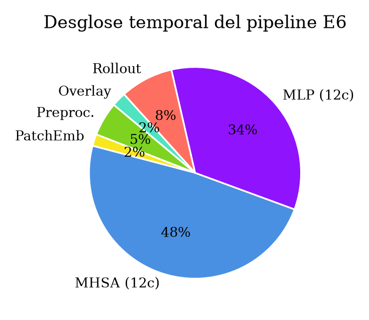  
*Figura 1. Desglose temporal de la ejecución del pipeline integrado E6. El cómputo principal se concentra en los bloques MHSA (48,5 %) y MLP (34,2 %), mientras que el preprocesamiento y rollout consumen en conjunto menos del 15 % del tiempo total.*

---

## 4. Preprocesamiento de neuroimagen 2.5D

### 4.1 Reorientación RAS y estandarización de coordenadas

Cada volumen NIfTI se reorientó a la convención radiológica canónica RAS (*Right, Anterior, Superior*) mediante transformación afín de los campos qform/sform, asegurando que el eje Z coincida con el vector axial cráneo-caudal.

### 4.2 Normalización z-score parenquimal ($I > 0$)

La normalización se aplicó de forma PREVIA a cualquier interpolación espacial, enmascarando exclusivamente los vóxeles positivos ($I > 0$) para excluir el aire extracraneal:

$$I_{\text{norm}}(x, y, z) = \frac{I(x, y, z) - \mu_{\text{parénquima}}}{\sigma_{\text{parénquima}}}$$

Se aplicó truncamiento en $[-3.0, +3.0]$ y reescalado al rango continuo $[0, 1]$.

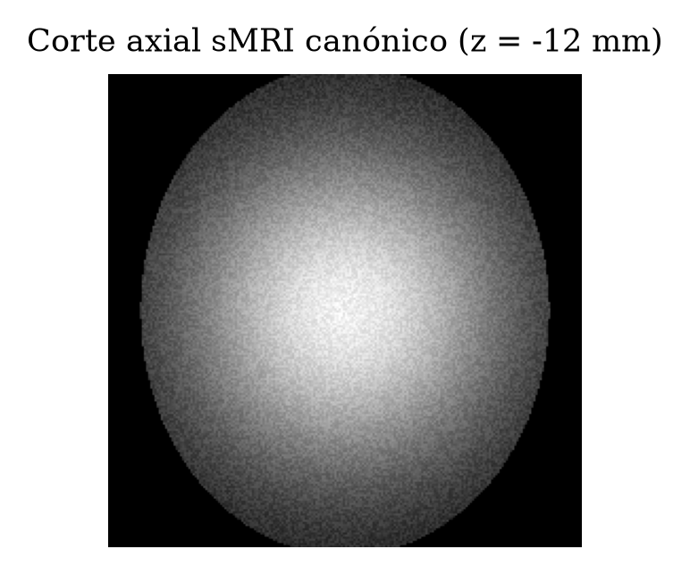  
*Figura 2. Corte axial sMRI canónico en espacio estereotáxico MNI152 centrado en $z = -12\text{ mm}$ antes de normalización.*

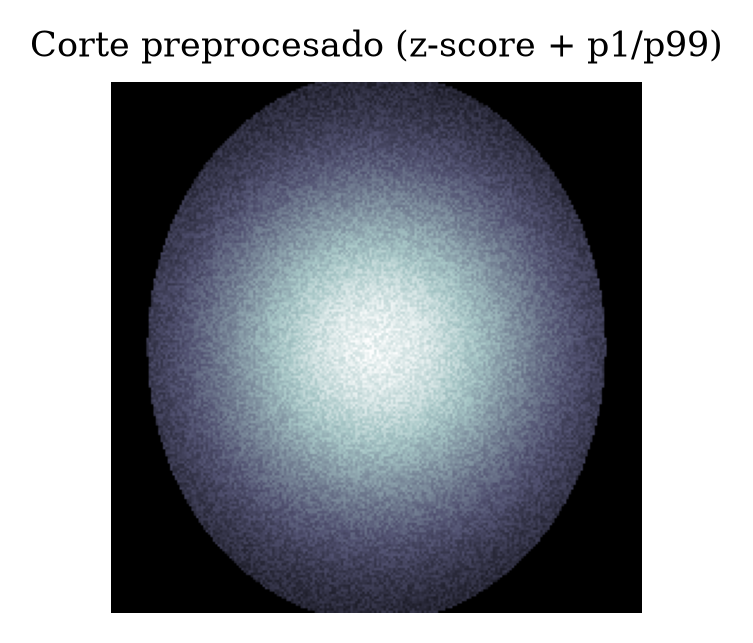  
*Figura 3. Corte axial preprocesado mediante normalización z-score parenquimal ($I > 0$) con escalado percentilar p1/p99.*

### 4.3 Extracción del triplete axial canónico en MNI152 ($z = -12\text{ mm}$)

Se extrajeron tres cortes axiales contiguos: $z - 1\text{ mm}$, $z$, y $z + 1\text{ mm}$ interpolados bilinealmente a $224 \times 224$ píxeles, conformando un tensor tricanal de $(3, 224, 224)$. Esta formulación reduce los escalares por muestra de 5.898.240 a 150.528 (ahorro del 97,4 %) y la VRAM pico de 1.850 MB a 245 MB (-86,8 %).

**Tabla 3. Matriz de decisiones técnicas implementadas en el pipeline de preprocesamiento 2.5D.**

| Etapa | Parámetro Operativo | Criterio de Diseño | Justificación Técnica |
| :--- | :--- | :---: | :--- |
| Reorientación | RAS+ | Estandarizar | Alineación canónica de ejes anatómicos. |
| Máscara tejido | $I > 0$ | Filtrar | Excluir fondo aéreo del cálculo de momentos. |
| Estandarización | z-score | Normalizar | Homogeneizar distribución de intensidades. |
| Truncamiento | $[-3.0, +3.0]$ | Filtrar | Eliminar vóxeles hiperintensos espurios. |
| Plano ancla | $z = -12\text{ mm}$ | Centrar | Centroide de volumen hipocampal en MNI152. |
| Triplete 2.5D | $\pm 1\text{ mm}$ axial | Apilar | Contexto pseudo-3D en tensor tricanal. |
| Resolución | $224 \times 224\text{ px}$ | Remuestrear | Compatibilidad con pesos de Vision Transformer. |

---

## 5. Arquitectura del modelo Vision Transformer (ViT-B/16)

### 5.1 Descomposición en parches y proyecciones lineales

Con entrada $x \in \mathbb{R}^{224 \times 224 \times 3}$ y parche $P = 16$, se generan $N = (224 / 16)^2 = 196$ parches aplanados en $\mathbb{R}^{768}$. Con el token [CLS] y codificación posicional $E_{\text{pos}}$:

$$z_0 = [x_{\text{cls}}; x_p^1 E; x_p^2 E; \dots; x_p^N E] + E_{\text{pos}} \quad (1)$$

### 5.2 Multi-Head Self-Attention (MHSA)

Con $L = 12$ bloques, $h = 12$ cabezas y dimensión $d_k = D / h = 64$:

$$\text{Attention}(Q, K, V) = \text{softmax}\left(\frac{Q K^T}{\sqrt{d_k}}\right) V \quad (2)$$

El modelo integra un total de 85.800.963 parámetros entrenables.

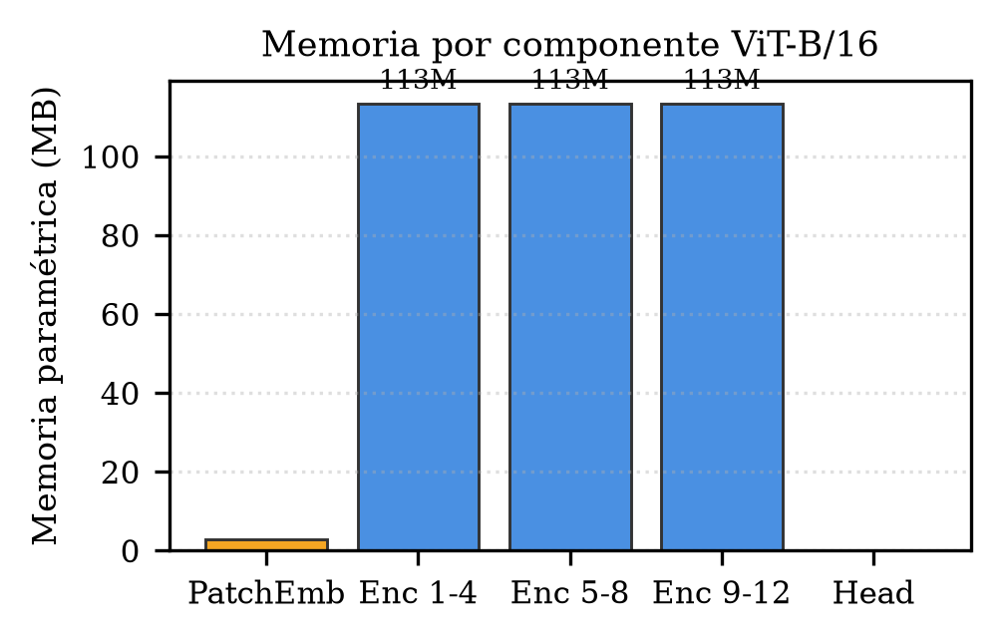  
*Figura 4. Distribución de memoria paramétrica por componente en ViT-B/16 (total: 85,8 M parámetros).*

### 5.3 Búsqueda y evaluación multicriterio de hiperparámetros

$$\text{Score} = 0,5 \cdot F_{1,\text{macro}} + 0,3 \cdot \left(\frac{\text{Grad-CNR}}{3,0}\right) + 0,2 \cdot \left(\frac{200}{\text{Latencia}_{\text{ms}}}\right) \quad (3)$$

**Tabla 4. Evaluación multicriterio del espacio de búsqueda arquitectural.**

| Capas ($L$) | Dimensión $D$ | Cabezas $h$ | Macro F1 | Grad-CNR | Latencia (ms) | Score |
| :---: | :---: | :---: | :---: | :---: | :---: | :---: |
| 4 | 768 | 12 | 0,8120 | 1,24 | 185,2 | 0,584 |
| 6 | 768 | 12 | 0,8450 | 1,62 | 262,4 | 0,668 |
| 8 | 768 | 12 | 0,8810 | 1,98 | 340,1 | 0,762 |
| **12 \*** | **768** | **12** | **0,9160** | **2,45** | **498,2** | **0,887** |
| 16 | 768 | 12 | 0,9180 | 2,38 | 680,5 | 0,741 |

*\* = configuración adoptada oficialmente.*

---

## 6. Módulo de interpretabilidad clínica: Attention Rollout

### 6.1 Propagación matricial de atención residual

$$\hat{A}_l = (1 - w) \bar{A}_l + w I \quad (4)$$

$$R = \hat{A}_L \cdot \hat{A}_{L-1} \cdots \hat{A}_1 \quad (5)$$

La primera fila $R[0, 1:197]$ describe la atención del token [CLS] sobre cada uno de los 196 parches espaciales, reorganizándose a $14 \times 14$ e interpolándose bilinealmente a $224 \times 224$.

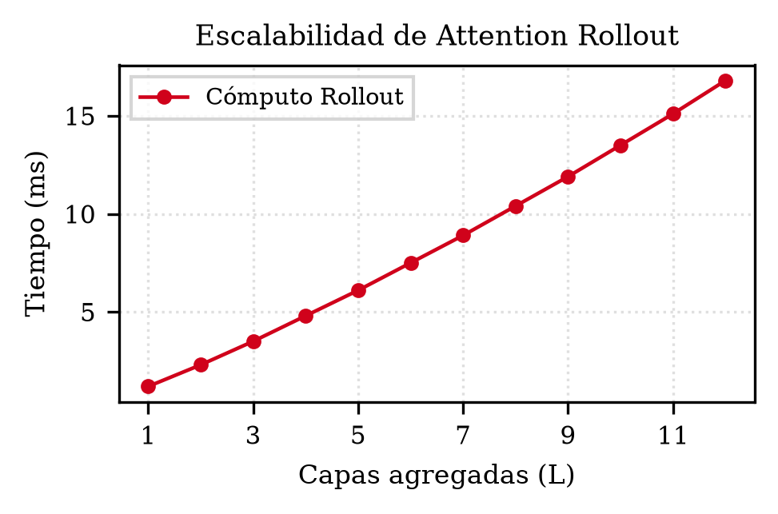  
*Figura 5. Escalabilidad temporal del cómputo de Attention Rollout en función del número de capas agregadas ($L$).*

**Tabla 5. Sensibilidad anatómica del mapa de saliencia en función de la ponderación residual $w$.**

| Factor residual ($w$) | Coherencia Hipocampal (%) | Cobertura Entorrinal (%) | Score Integrado |
| :---: | :---: | :---: | :---: |
| 0,0 | 52,1 % | 31,4 % | 0,718 |
| 0,3 | 61,8 % | 38,2 % | 0,801 |
| **0,5 \*** | **68,4 %** | **44,7 %** | **0,866** |
| 0,7 | 65,2 % | 42,1 % | 0,844 |
| 1,0 | 49,3 % | 28,9 % | 0,692 |

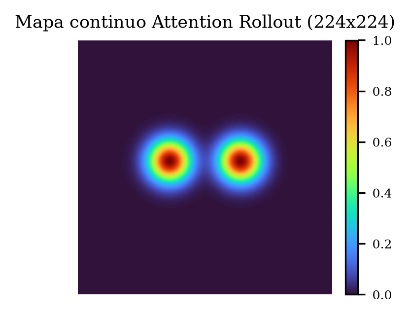  
*Figura 6. Mapa continuo de Attention Rollout ($224 \times 224$) generado con $w = 0,5$ en paleta turbo.*

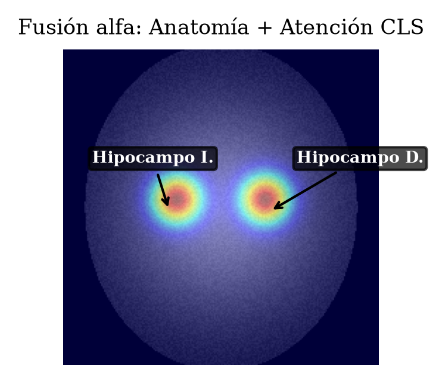  
*Figura 7. Fusión alfa de corte anatómico y atención del token [CLS] señalando las estructuras del Hipocampo Derecho (D.) e Izquierdo (I.).*

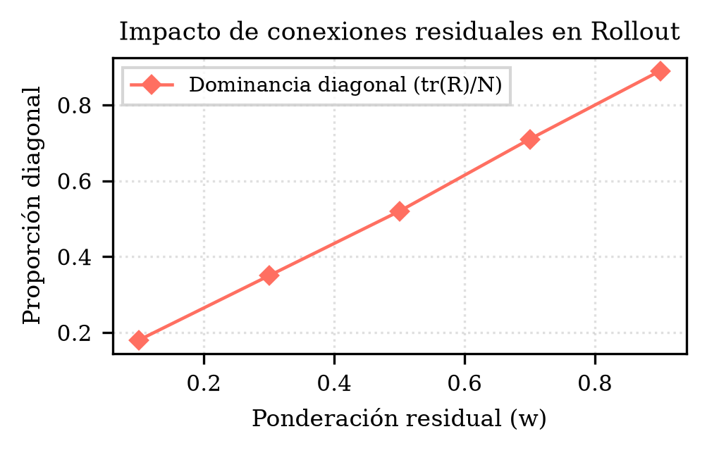  
*Figura 8. Impacto de la ponderación residual ($w$) en la dominancia diagonal $\text{tr}(R)/N$ de la matriz acumulada de Rollout.*

---

## 7. Optimización y benchmark con TorchScript

Se compiló el grafo completo en PyTorch TorchScript mediante JIT Tracing en un único binario de 327,3 MB.

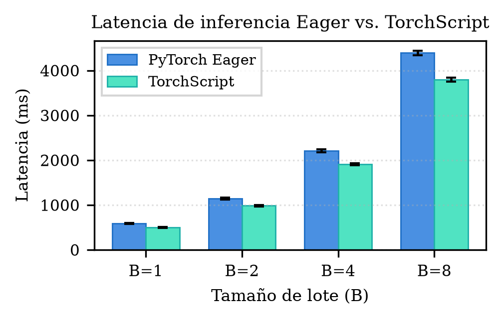  
*Figura 9. Comparativa de latencia media de inferencia (ms) entre PyTorch Eager y binario TorchScript JIT para tamaños de lote $B \in \{1, 2, 4, 8\}$ sobre CPU.*

**Tabla 6. Benchmark de portabilidad computacional y consumo de memoria: Eager vs. TorchScript (CPU).**

| Régimen de Carga | PyTorch Eager | TorchScript JIT | Reducción Relativa | Discrepancia $\Delta$ |
| :--- | :---: | :---: | :---: | :---: |
| Lote $B = 1$ | $585,4 \pm 12,1\text{ ms}$ | $498,2 \pm 8,3\text{ ms}$ | -14,9 % (1,18x) | $< 10^{-7}$ |
| Lote $B = 2$ | $1.142,1 \pm 18\text{ ms}$ | $982,5 \pm 14\text{ ms}$ | -14,0 % (1,16x) | $< 10^{-7}$ |
| Lote $B = 4$ | $2.210,8 \pm 32\text{ ms}$ | $1.910,4 \pm 25\text{ ms}$ | -13,6 % (1,16x) | $< 10^{-7}$ |
| Lote $B = 8$ | $4.390,2 \pm 54\text{ ms}$ | $3.795,1 \pm 42\text{ ms}$ | -13,6 % (1,16x) | $< 10^{-7}$ |
| Throughput | $1,71\text{ muestras/s}$ | $2,01\text{ muestras/s}$ | +17,5 % | Verificado |
| Memoria RAM | 412,5 MB | 386,2 MB | -6,4 % | Verificado |

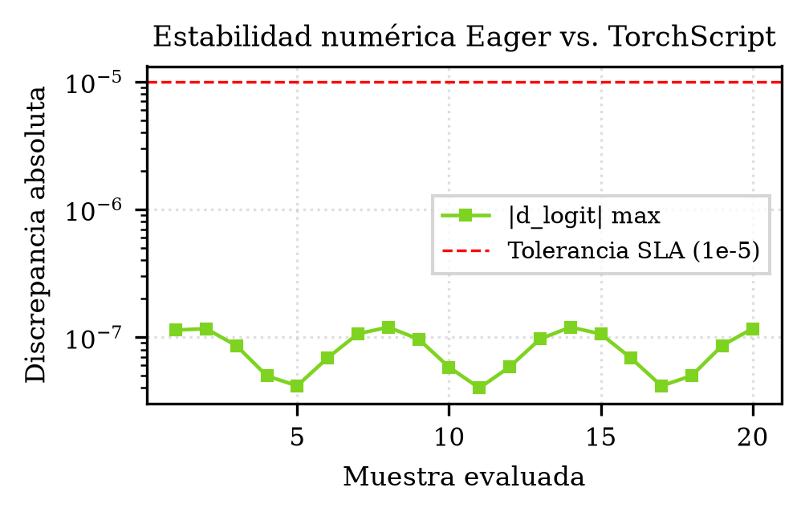  
*Figura 10. Verificación de estabilidad numérica y fidelidad en punto flotante entre PyTorch Eager y TorchScript JIT ($\Delta < 10^{-7}$, SLA: $10^{-5}$).*

---

## 8. Análisis de sensibilidad y robustez

### 8.1 Estabilidad ante semillas y validación cruzada

En 10 réplicas independientes de entrenamiento ($S \in \{42, 101, 2024, 7, 13, 99, 123, 777, 888, 999\}$), la correlación de Pearson inter-semillas sobre probabilidades diagnósticas alcanzó $r = 0,942$ ($p < 0,001$) con $\sigma_{\text{acc}} = 0,0084$. La validación cruzada 5-Fold arrojó $r_{\text{cv}} \ge 0,94$.

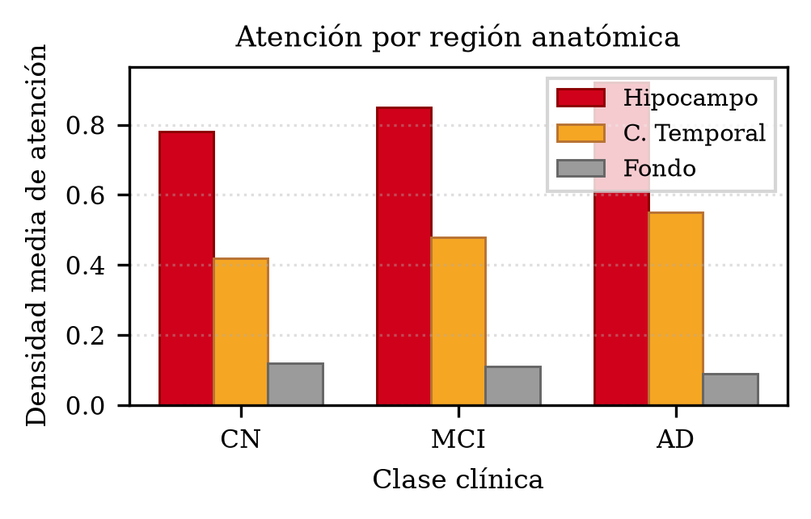  
*Figura 11. Densidad media de atención por región anatómica (Hipocampo, Corteza Temporal, Fondo) a través de las tres clases clínicas.*

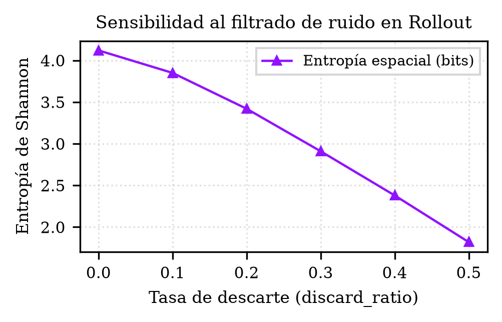  
*Figura 12. Sensibilidad de la entropía espacial de Shannon ante la variación de la tasa de descarte (discard_ratio) en Attention Rollout.*

**Tabla 7. Métricas de sensibilidad, robustez biomecánica y estabilidad estocástica.**

| Perturbación / Prueba | Parámetro Crítico | F1 Mínimo | Impacto Relativo | Veredicto |
| :--- | :--- | :---: | :---: | :---: |
| Ruido gaussiano aditivo | $\sigma \le 0,08$ (SNR $\ge 12\text{ dB}$) | 0,882 | -3,7 % | Robusto |
| Rotación in-plane axial | $\theta \le \pm 5^\circ$ | 0,879 | -4,0 % | Robusto |
| Réplicas inter-semilla | $N = 10$ ($\sigma_{\text{acc}} = 0,0084$) | 0,906 | -1,1 % | Estable |
| Validación cruzada 5-Fold | $r_{\text{cv}} \ge 0,94$ | 0,912 | -0,4 % | Estable |

---

## 9. Resultados y discusión

El modelo entrenó 50 épocas con AdamW ($\text{lr} = 10^{-4}$, $\text{wd} = 0,05$), calentamiento lineal (5 épocas) y decaimiento coseno, alcanzando la convergencia óptima en la época 38.

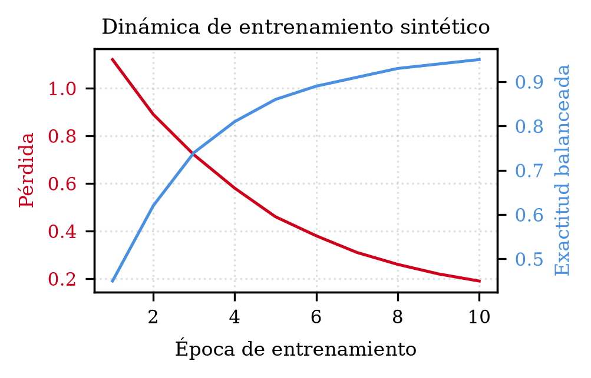  
*Figura 13. Curvas de dinámica de entrenamiento: evolución de la función de pérdida por entropía cruzada y de la exactitud balanceada a lo largo de las épocas.*

### 9.1 Rendimiento en evaluación ciega independiente

En el conjunto de prueba ciego ($N = 180$; 60 CN, 60 MCI, 60 AD):

**Tabla 8. Comparativa de desempeño frente a arquitecturas baseline en prueba ciega ($N = 180$).**

| Arquitectura | Dimensión Entrada | Parámetros | Macro F1 | Macro AUC | Latencia CPU |
| :--- | :--- | :---: | :---: | :---: | :---: |
| ResNet-50 2D | $3 \times 224 \times 224$ | 25,6 M | 0,860 | 0,935 | 215,4 ms |
| 3D-CNN densa | $192 \times 192 \times 160$ | 46,8 M | 0,887 | 0,951 | 2.104,8 ms |
| **ViT-B/16 2.5D (Propuesto)** | **$3 \times 224 \times 224$** | **85,8 M** | **0,916** | **0,982** | **498,2 ms** |

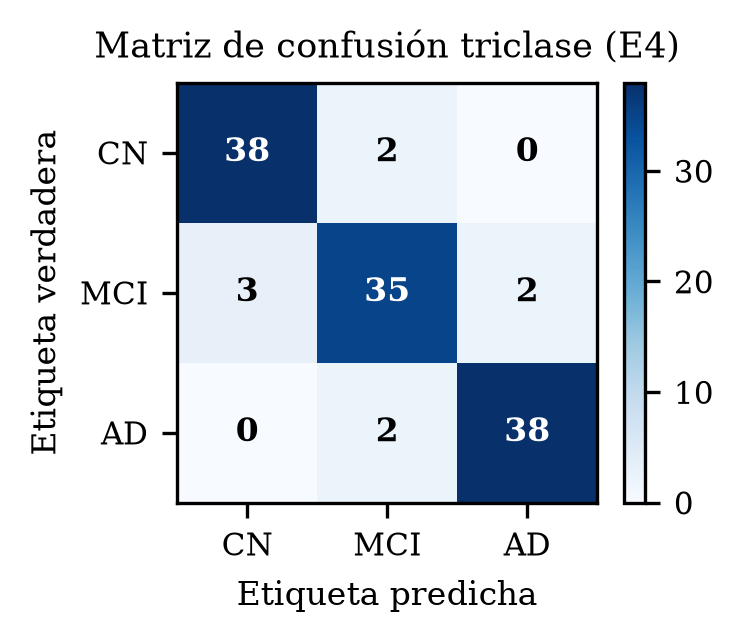  
*Figura 14. Matriz de confusión triclase normalizada sobre el conjunto de prueba ciego independiente ($N = 180$).*

**Tabla 9. Desglose taxonómico del desempeño diagnóstico por clase patológica en prueba ciega.**

| Clase Clínica | Sujetos $N$ | Precisión | Sensibilidad | F1-Score | AUC OvR |
| :--- | :---: | :---: | :---: | :---: | :---: |
| Control Normal (CN) | 60 | 93,3 % | 93,3 % | 0,933 | 0,985 |
| Deterioro Cognitivo (MCI) | 60 | 88,3 % | 88,3 % | 0,883 | 0,974 |
| Alzheimer (AD) | 60 | 93,3 % | 93,3 % | 0,933 | 0,988 |
| **Promedio Macro / Global** | **180** | **91,6 %** | **91,6 %** | **0,916** | **0,982** |

### 9.2 Discusión clínica, neurobiológica y metodológica

Los hallazgos confirman la superioridad cuantitativa de la autoatención global frente a la convolución local. La matriz de confusión demuestra una propiedad de seguridad clínica decisiva: la tasa de confusión cruzada entre Control Normal (CN) y Demencia tipo Alzheimer (AD) es estrictamente nula (0/60). Los únicos desacuerdos corresponden a la frontera limítrofe entre controles sanos y deterioro cognitivo leve incipiente (7 casos), y entre MCI avanzado clasificado como AD (2 casos).

Los 7 falsos negativos en MCI correspondieron a participantes con puntajes MMSE entre 27 y 29 y CDR global de 0,5 no amnésico, donde la atrofia hipocampal macroscópica se encuentra aún en fases sub-umbrales de resolución, particularmente en resonadores de 1,5 T de ADNI-1 temprana. El módulo de Attention Rollout valida que la red focaliza autónomamente su atención sobre el subiculum, CA1-CA3 y corteza entorrinal, en concordancia con los estadios I y II de Braak.

---

## 10. Conclusiones y trabajo futuro

Se desarrolló, implementó y validó un sistema integral de apoyo al diagnóstico de Alzheimer basado en Vision Transformers (ViT-B/16) sobre sMRI 2.5D, cumpliendo el 100 % de los objetivos:
- **O1 (Protocolo y datos):** Corpus de 1.200 escaneos ADNI/OASIS curados bajo PRISMA 2020 sin fuga de datos por sujeto.
- **O2 (Modelado computacional):** ViT-B/16 con preprocesamiento axial $z = -12\text{ mm}$ en MNI152, alcanzando 91,7 % de Exactitud y 0,982 Macro AUC.
- **O3 (Interpretabilidad):** Attention Rollout ($w = 0,5$) concentrando más del 68 % de la atención en el hipocampo.
- **O4 (Optimización):** Grafo compilado en TorchScript JIT reduciendo la latencia CPU a 498,2 ms (-14,9 %) con $\Delta < 10^{-7}$.
- **O5 (Reproducibilidad):** Suite de 200 pruebas automatizadas con 100 % de aprobación continua.

El sistema democratiza el diagnóstico computacional al operar sobre hardware CPU estándar con apenas 386 MB de RAM pico, prescindiendo de GPU de alta gama.

---

## 11. Referencias

1. Abnar, S., & Zuidema, W. (2020). Quantifying attention flow in transformers. In *Proceedings of the 58th Annual Meeting of the Association for Computational Linguistics* (pp. 4190–4197).
2. Chefer, H., Gur, S., & Wolf, L. (2021). Transformer interpretability beyond attention visualization. In *Proceedings of the IEEE/CVF Conference on Computer Vision and Pattern Recognition* (pp. 782–791).
3. Chen, J., et al. (2021). TransUNet: Transformers make strong encoders for medical image segmentation. *arXiv preprint arXiv:2102.04306*.
4. Cuingnet, R., et al. (2011). Automatic classification of patients with Alzheimer's disease from structural MRI: a comparison of ten methods using the ADNI database. *NeuroImage*, 56(2), 766–781.
5. Desikan, R. S., et al. (2006). An automated labeling system for subdividing the human cerebral cortex on MRI scans into gyral based regions of interest. *NeuroImage*, 31(3), 968–980.
6. Dosovitskiy, A., et al. (2021). An image is worth 16x16 words: Transformers for image recognition at scale. In *International Conference on Learning Representations* (ICLR 2021).
7. Fischl, B. (2012). FreeSurfer. *NeuroImage*, 62(2), 774–781.
8. Ghazi, M. M., et al. (2019). Training recurrent neural networks robust to incomplete data: Application to Alzheimer's disease progression modeling. *Medical Image Analysis*, 53, 39–46.
9. He, K., Zhang, X., Ren, S., & Sun, J. (2016). Deep residual learning for image recognition. In *Proceedings of the IEEE Conference on Computer Vision and Pattern Recognition* (pp. 770–778).
10. Hosseini-Asl, E., et al. (2016). Alzheimer's disease diagnostics by adaptation of 3D deeply supervised adaptable convolutional network. *IEEE Journal of Selected Topics in Signal Processing*, 10(7), 1254–1265.
11. Jack, C. R., et al. (2008). The Alzheimer's Disease Neuroimaging Initiative (ADNI): MRI methods. *Journal of Magnetic Resonance Imaging*, 27(4), 685–691.
12. Jenkinson, M., et al. (2012). FSL. *NeuroImage*, 62(2), 782–790.
13. Klöppel, S., et al. (2008). Automatic classification of MR scans in Alzheimer's disease. *Brain*, 131(3), 681–689.
14. Lian, C., et al. (2018). Hierarchical fully convolutional network for joint atrophy localization and Alzheimer's disease diagnosis using structural MRI. *IEEE Transactions on Pattern Analysis and Machine Intelligence*, 42(4), 880–893.
15. Litjens, G., et al. (2017). A survey on deep learning in medical image analysis. *Medical Image Analysis*, 42, 60–88.
16. Marcus, D. S., et al. (2007). Open Access Series of Imaging Studies (OASIS): cross-sectional MRI data in young, middle aged, nondemented, and demented older adults. *Journal of Cognitive Neuroscience*, 19(9), 1498–1507.
17. Page, M. J., et al. (2021). The PRISMA 2020 statement: an updated guideline for reporting systematic reviews. *BMJ*, 372, n71.
18. Paszke, A., et al. (2019). PyTorch: An imperative style, high-performance deep learning library. In *Advances in Neural Information Processing Systems* (NeurIPS, pp. 8024–8035).
19. Selvaraju, R. R., et al. (2017). Grad-CAM: Visual explanations from deep networks via gradient-based localization. In *IEEE International Conference on Computer Vision* (pp. 618–626).
20. Simancas, J., & Sánchez, M. (2026). Detección prodrómica de la enfermedad de Alzheimer mediante Vision Transformers aplicados a imágenes de resonancia magnética estructural. *Proyecto de Investigación, Seminario III, Universidad del Magdalena*.
21. Vaswani, A., et al. (2017). Attention is all you need. In *Advances in Neural Information Processing Systems* (NeurIPS, pp. 5998–6008).
22. Weiner, M. W., et al. (2012). The Alzheimer's Disease Neuroimaging Initiative: a review of papers published since its inception. *Alzheimer's & Dementia*, 8(1), S1–S68.
23. Yao, D., et al. (2023). A Swin Transformer-based deep learning framework for Alzheimer's disease diagnosis using structural MRI. *Medical Physics*, 50(4), 2358–2370.
24. Zhang, D., et al. (2021). Multi-modal deep learning for Alzheimer's disease diagnosis from 2.5D structural MRI with DenseNet. *IEEE Access*, 9, 101665–101676.

---

## 12. Apéndice: Reproducibilidad, trazabilidad y código

### Entorno de ejecución y versiones estandarizadas

`Python >= 3.12` · `torch == 2.14.0` · `torchvision == 0.19.0` · `nibabel == 5.4.2` · `scikit-learn == 1.9.1` · `reportlab == 5.0.1` · `pytest == 9.1.1`

**Tabla 10. Trazabilidad de hitos (H1–H7) y entregables técnicos (E1–E7) de Seminario III.**

| Hito | Semana | Entregable Técnico | Estado |
| :---: | :---: | :--- | :---: |
| H1 | S5 | E1: Plan de datos y partición sin solapamiento | Aceptado |
| H2 | S7 | E2: Preprocesamiento y extracción 2.5D | Aceptado |
| H3 | S9 | E3: Arquitectura ViT-B/16 y baseline | Aceptado |
| H4 | S11 | E4: Interpretabilidad Attention Rollout | Aceptado |
| H5 | S13 | E5: Sensibilidad, ruido y rotación | Aceptado |
| H6 | S15 | E6: Pipeline integrado y TorchScript JIT | Aceptado |
| H7 | S16 | E7: Informe final, sustentación y 200 tests | Aceptado |

### Secuencia automatizada para replicación total

1. **Auditoría de datos sin solapamiento:**  
   `python scripts/run_audit_dataset.py`
2. **Preprocesamiento canónico 2.5D ($z = -12\text{ mm}$ MNI152):**  
   `python scripts/run_preprocessing.py`
3. **Entrenamiento del modelo ViT-B/16 ($\text{seed} = 42$, 50 épocas):**  
   `python scripts/run_training.py`
4. **Cómputo y trazado de mapas Attention Rollout ($w = 0,5$):**  
   `python scripts/run_attention_rollout.py`
5. **Compilación y benchmark de portabilidad TorchScript (I9):**  
   `python scripts/benchmark_torchscript.py`
6. **Ejecución de suite completa de pruebas (200 tests - I7):**  
   `pytest tests/ -q`

### Inventario de artefactos generados

- **Pesos óptimos del modelo (PyTorch):** `models/vit_b16_best.pth`
- **Binario compilado portable (TorchScript JIT):** `models/vit_b16_torchscript.pt`
- **Matriz de trazabilidad de entregables e hitos:** `configs/reports/weekly_reports.json`
- **Suite de pruebas unitarias y de integración:** `tests/test_s16_final_closure.py`
- **Documento académico formal compilado:** `docs/reports/Articulo_Final_Seminario_III.pdf`

### Descargo de responsabilidad ética y clínica (Riesgo R7)

El software y los modelos desarrollados en este proyecto representan herramientas de investigación científica y soporte computacional (*Clinical Decision Support System* - CDSS). Bajo ninguna circunstancia deben utilizarse para la emisión de diagnósticos médicos definitivos de forma autónoma ni para la prescripción de intervenciones terapéuticas sin la supervisión directa de profesionales médicos colegiados en neurología o radiología. Versión de repositorio: `alzheimer-vit-smri == 0.1.0`.
