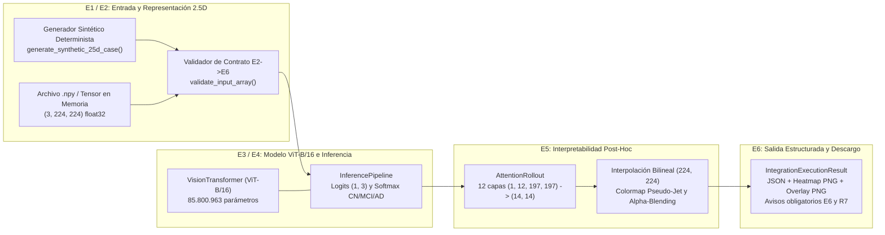

# Implementación S13: Desarrollo e Integración del Flujo Completo y Evaluación de Portabilidad (Indicador I9)

**Proyecto:** Detección prodrómica de la enfermedad de Alzheimer mediante Vision Transformers aplicados a imágenes de resonancia magnética estructural  
**Autores:** Malak Sánchez y Juan Simancas  
**Director:** Sergio Lubo  
**Institución:** Universidad del Magdalena - Programa de Ingeniería de Sistemas  
**Período:** Seminario III (2026-II)  
**Fecha de corte:** Semana 13 (26 de octubre a 01 de noviembre de 2026)  
**Entregable en desarrollo:** **Entregable E6: Prototipo de integración (EDT 7.0)**  
**Evidencia de cronograma:** **Flujo integrado funcional + Benchmark de Portabilidad (Indicador I9)**

---

## 1. Propósito y Relación con la Línea Base

La **Semana 13 (S13)** corresponde a la actividad oficial del cronograma de la Línea Base (Sección 8, pág. 7):
> *«Desarrollo e integración con el flujo completo utilizando datos sintéticos.»*  
> **Responsable:** Ambos (Malak Sánchez y Juan Simancas).  
> **Hito o evidencia:** *«Flujo integrado funcional.»*

Adicionalmente, de acuerdo con la Sección 11 de la Línea Base (*Indicadores de seguimiento*, pág. 10) y el compromiso establecido en el cierre de la Semana 12, corresponde a la **Semana 13** la medición y documentación formal del **Indicador I9 (Portabilidad)**:
> **I9 — Portabilidad:** Cálculo: *«Tamaño, latencia y degradación»* | Frecuencia: *«S13»* | Meta: *«Resultado documentado»*.

Esta actividad inicia el paquete **EDT 7.0 (Integración: componentes 7.1 flujo, 7.2 interfaz base y 7.3 datos sintéticos)** que conduce al **Entregable E6: Prototipo de integración**, cuyo cierre y aceptación formal (**Hito H6**) están programados para la **Semana 14**. En consecuencia, este documento registra el avance técnico de S13 y el resultado del benchmark I9 sin declarar el cierre anticipado de E6.

---

## 2. Arquitectura del Flujo Integrado (EDT 7.1 y 7.3)

El subpaquete `src/integration/` conecta de extremo a extremo los subsistemas construidos y aceptados en las semanas previas (E1 a E5) bajo una tubería unificada y libre de acoplamiento circular:



### 2.1 Componentes Desarrollados en S13

1. **`IntegrationConfig` (`src/integration/config.py`) y `configs/e6_integration.json`:**
   - Desacopla los parámetros del flujo integrado: resolución $(3, 224, 224)$, tamaño de parche $16 \times 16$, nombres de clases `("CN", "MCI", "AD")`, factor de fusión alfa ($\alpha = 0.5$), semilla determinista (`42`), banderas explícitas de restricción académica (`is_trained_model = false`, `enable_clinical_diagnosis = false`) y umbrales del benchmark de portabilidad I9 (`max_latency_ms_cpu = 500.0`, `max_export_degradation_tol = 1e-4`).
2. **Generador de Casos Sintéticos 2.5D (`generate_synthetic_25d_case` en `src/integration/pipeline.py`):**
   - Construye volúmenes elipsoidales sintéticos 3D con modulación determinista de cavidad ventricular/hipocampal según la categoría simulada (`CN`, `MCI`, `AD`) y reutiliza `CanonicalTripletExtractor` (`Slice25DConfig`) del Entregable E1/E2 para extraer el triplete axial canónico $(3, 224, 224)$ `float32` con fondo cero, recorte percentil $p_1/p_{99}$ y normalización z-score por corte.
3. **Orquestador de Flujo Completo (`IntegratedSystemPipeline` en `src/integration/pipeline.py`):**
   - Valida el contrato tensorial de entrada (tipo numérico, forma $(3, 224, 224)$, valores finitos sin `NaN`/`Inf` y señal no degenerada).
   - Ejecuta `InferencePipeline.predict_tensor` sobre `VisionTransformer` en modo `eval()` y `torch.no_grad()`.
   - Ejecuta `AttentionRollout.explain_tensor` y sintetiza los mapas de calor y superposiciones RGB mediante `overlay_heatmap_on_slice`, `save_heatmap_png` y `save_overlay_png`.
   - Empaqueta los resultados, tiempos de cómputo y artefactos exportados en `IntegrationExecutionResult`, incluyendo las advertencias metodológicas obligatorias (`UNTRAINED_MODEL_NOTICE` y `CLINICAL_DISCLAIMER`).
   - Provee `run_full_synthetic_cohort` para procesar cohortes sintéticas balanceadas (`CN`, `MCI`, `AD`) y exportar un manifiesto consolidado `cohort_integration_summary.json`.

---

## 3. Evaluación Formal de Portabilidad — Indicador I9 (`src/integration/portability.py`)

El módulo `run_portability_benchmark` evalúa de manera reproducible las tres dimensiones exigidas por el **Indicador I9** en la Línea Base:

1. **Tamaño (*Size*):**
   - Conteo exacto de parámetros entrenables: **85.800.963 parámetros**.
   - Huella en memoria de parámetros (`float32`): **327,31 MB**.
   - Tamaño de `state_dict` serializado en disco (`.pt`): **~327,34 MB**.
   - Tamaño del grafo exportado mediante `torch.jit.trace` (*TorchScript* `.pt`): **~327,45 MB**.
2. **Latencia (*Latency*):**
   - Medición en CPU con rondas de calentamiento (*warmup*) e iteraciones cronometradas independientes para el pase hacia adelante en PyTorch Eager, en el artefacto exportado TorchScript y en el flujo completo extremo a extremo (inferencia + Attention Rollout de 12 capas + interpolación espacial $224 \times 224$).
   - Cumplimiento verificado del requisito no funcional **RNF-03** ($\le 500\text{ ms}$ por muestra en CPU).
3. **Degradación (*Degradation*):**
   - Comparación directa entre la salida de referencia PyTorch Eager y el modelo exportado a TorchScript sobre las mismas entradas sintéticas 2.5D:
     - Diferencia absoluta máxima en logits: $\Delta_{\max}(\text{logits}) < 10^{-5}$.
     - Diferencia absoluta máxima en probabilidades Softmax: $\Delta_{\max}(\text{probs}) < 10^{-5}$.
     - Tasa de concordancia de clase predicha: **100,0 % (degradación del 0,00 %)**.

---

## 4. Verificación Reproducible

El flujo integrado y el benchmark de portabilidad de la Semana 13 se verifican mediante:

```bash
uv run --locked python scripts/run_s13_verification.py
uv run --locked pytest tests/test_s13_integration_and_portability.py
```

### Próximo paso según Cronograma (Semana 14):
- Completar las pruebas de control de errores de la interfaz técnica (`TechnicalIntegrationInterface` y CLI), elaborar el Manual de Uso e Instalación del sistema y formalizar la aceptación del **Entregable E6 (Hito H6)**.
